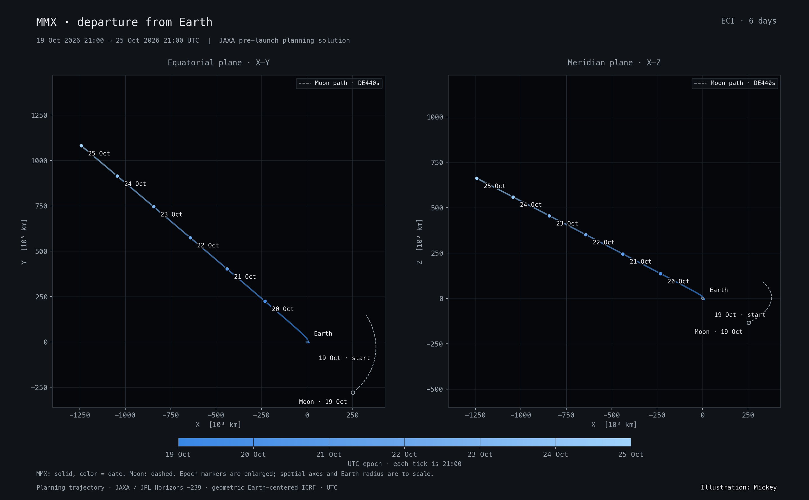

# MMX Earth Departure

**[Open the interactive orbit viewer](https://exoplanet5.github.io/MMX/)** · [Scientific study](study.md) · [CSV ephemeris](docs/data/mmx_eci.csv) · [JSON states](docs/data/ephemeris.json)

An Earth-centered inertial study of JAXA's Martian Moons eXploration spacecraft, **JPL Horizons ID −239**, covering **2026-10-19 21:00:00 to 2026-10-25 21:00:00 UTC**, inclusive.

> **Pre-launch planning trajectory, not flight reconstruction.** The source is JAXA `20261019_20281231_MMX_V0.2`, accessed through JPL Horizons on October 16, 2026. The trajectory can change. No orbit covariance or prediction-accuracy envelope was supplied.

## Findings

| Quantity | 19 Oct, 21:00 UTC | 25 Oct, 21:00 UTC |
|---|---:|---:|
| Distance from Earth's center | 8,703.971 km | 1,776,012.255 km |
| Earth-relative inertial speed | 10.077174 km/s | 3.227642 km/s |
| Distance from the Moon's center | 399,534.546 km | 1,911,515.309 km |

Earth range and Moon separation increase at every one-minute sample. The smallest sampled lunar separation is at the **start boundary**, not at a lunar flyby. The interval begins after launch; the viewer does not reconstruct ascent or any earlier trajectory.

The initial Earth-only osculating eccentricity is **1.168754**, and instantaneous C3 is **9.958959 km²/s²**, consistent with an Earth-escape state. These are instantaneous diagnostics, not a Keplerian propagation model.

## Figures

All four figures use the same canonical states as the viewer. PNGs are 2880 × 1782 pixels, with equal physical scale on spatial axes, UTC labeling and explicit planning-data attribution.

| Figure | Content |
|---|---|
| [ECI overview](docs/plots/01_eci_overview.png) | Full-window X–Y and X–Z projections, daily epochs and contemporaneous lunar context |
| [3D ECI view](docs/plots/02_eci_3d.png) | Full-window three-dimensional departure geometry |
| [Departure detail](docs/plots/03_departure_zoom.png) | First three hours, with Earth drawn at its true radius |
| [Distance and speed](docs/plots/04_range_speed.png) | Earth range, Moon separation and inertial speed on separate panels |



## Interactive viewer

The viewer includes:

- Orbit, zoom and pan controls; full-path, departure, XY, XZ and YZ camera presets.
- UTC scrubbing, playback, speed selection, exact date input and day/endpoint jumps.
- Earth rotation in a **nonrotating inertial scene**, simultaneous Moon position, and labeled inertial axes.
- Live geometric state readouts, linked diagnostic charts, a paginated sample table and full-precision CSV/JSON downloads.
- Keyboard controls, mobile panels, a non-WebGL fallback and reduced-motion support.
- Copyable view links containing epoch and camera state.

**`docs/index.html` is standalone (about 5.1 MiB).** Double-click it or open it in a browser; it embeds its JavaScript, trajectory data and NASA Earth texture. It makes no runtime network requests and requires no server or CDN. Linked static figures require the adjacent `docs/plots/` directory, or use their public website URLs. Data downloads work from the embedded dataset.

Default playback is paused. The timeline's elapsed time is measured from **19 October 21:00 UTC**, not from launch. All portions of the displayed path are planning states; moving the time slider does not make them flown states.

## Scientific conventions

- **Origin:** Earth's center, Horizons `CENTER='500@399'`.
- **Axes:** ICRF equatorial inertial axes, `REF_SYSTEM='ICRF'`, **`REF_PLANE='FRAME'`**. ICRF is closely aligned with J2000, but is not exactly FK5/J2000. This is neither ecliptic nor Earth-fixed.
- **State type:** geometric Cartesian position and velocity, `VEC_CORR='NONE'`.
- **Units:** km and km/s.
- **Epochs:** `TIME_TYPE='UT'`, which Horizons defines as UTC for these modern dates. The six-day interval contains **8,641 samples at 60-second cadence**.
- **Moon/Sun context:** simultaneous geometric DE440s states, evaluated after proper UTC-to-TDB conversion. Horizons identifies DE441 for its Earth center; seven independent lunar comparisons measure the small contextual difference.
- **Display rotation:** `(X,Y,Z) → (X,Z,−Y)/6378.137`, a right-handed change to Three.js's Y-up display axes. Numeric readouts stay in original ECI coordinates.
- **Earth orientation:** precomputed Skyfield ITRS-to-ICRF quaternions; bundled timescale data, precession/nutation and UT1, with polar motion omitted. Earth rotation never rotates the spacecraft trajectory. The globe is spherical, radius 6,378.137 km; point markers are enlarged independently.

### Validation

The one-minute trajectory was checked against **8,640 additional Horizons states at the intervening 30-second epochs**:

| Check | Largest measured residual |
|---|---:|
| Cubic Hermite position vs. withheld Horizons positions | **5.281 m** |
| Derivative velocity vs. withheld Horizons velocities | **2.233 m/s** |
| DE440s Moon position vs. seven Horizons checks | **2.469 m** |

These are **interpolation and cross-ephemeris checks**, not estimates of future spacecraft prediction uncertainty. The maximum position and velocity residuals occur in the first two minutes of the interval; exact sample states retain the original Horizons velocities. Position and speed are never extrapolated.

## Reproduce

Python defaults to `~/.venvs/astro313/bin/python`. Use the shared kernel **`~/JPLDE/de440s.bsp`**; do not place a DE kernel in this repository. Required Python package versions are recorded in `requirements.txt`. Node/npm are needed only to rebuild or test the HTML, not to view it.

```sh
# Rebuild canonical data from the archived snapshot, without network access.
~/.venvs/astro313/bin/python -I src/ephemeris.py

# Rebuild figures.
~/.venvs/astro313/bin/python -I src/plots.py

# Install pinned build/test dependencies without package lifecycle scripts.
npm ci --ignore-scripts
npm run build

# Numerical, interpolation and browser checks.
~/.venvs/astro313/bin/python -I tests/test_ephemeris.py
npm test
npm run test:browser
```

Browser checks use an existing Chrome installation. The macOS default is `/Applications/Google Chrome.app/Contents/MacOS/Google Chrome`; set `CHROME_PATH` to another Chrome/Chromium executable when needed. No browser download is required. Screenshots and test downloads go to ignored `test-results/`.

A **network refresh is explicit**, and writes a new immutable raw snapshot:

```sh
~/.venvs/astro313/bin/python -I src/ephemeris.py --refresh
# Optional explicit inputs:
~/.venvs/astro313/bin/python -I src/ephemeris.py --snapshot data/raw/<snapshot> --kernel ~/JPLDE/de440s.bsp
```

Review the new source/version, diagnostics and interpolation residuals before deploying refreshed data. The report's quoted results refer to the original archived planning snapshot. Python scripts communicate through JSON and work with isolated mode (`-I`).

## Repository layout

- `data/raw/<snapshot>/`: original Horizons responses, requests, retrieval times and SHA-256 manifest.
- `src/ephemeris.py`: fetch/cache validation, planetary context, Earth orientation, canonical exports and fixtures.
- `src/plots.py`: the four publication figures, generated from canonical JSON.
- `web/`: maintained UI/rendering/interpolation sources, vendored Three.js r170 and reduced-resolution Earth image.
- `scripts/build_site.mjs`: bundles all runtime dependencies into one HTML file.
- `docs/`: published standalone page, normalized data, provenance, summary and figures.
- `tests/`: Python acceptance checks, JavaScript interpolation tests, shared reference fixtures and browser checks.

GitHub Pages serves **`main` → `/docs`**. No backend, live Horizons calls, external runtime assets or Actions build workflow is required.

## Attribution and sources

Illustration: **Mickey**. Visual treatment follows the Chang'e 3 ECI study and the Starship IFT-14 viewer. Zhuque-2E-Y7 supplied a diagnostic-plot reference; its inspected checkout did not contain an interactive page.

- [JPL Horizons](https://ssd.jpl.nasa.gov/horizons/) and [API documentation](https://ssd-api.jpl.nasa.gov/doc/horizons.html).
- [JAXA MMX mission](https://www.mmx.jaxa.jp/en/mission/).
- NASA Blue Marble Earth base image.
- [Third-party notices](THIRD_PARTY_NOTICES.md), including the Starship reference and Three.js MIT licenses.

The repository retains its Apache-2.0 [LICENSE](LICENSE). This is an independent study and is not an official JAXA or JPL service.
